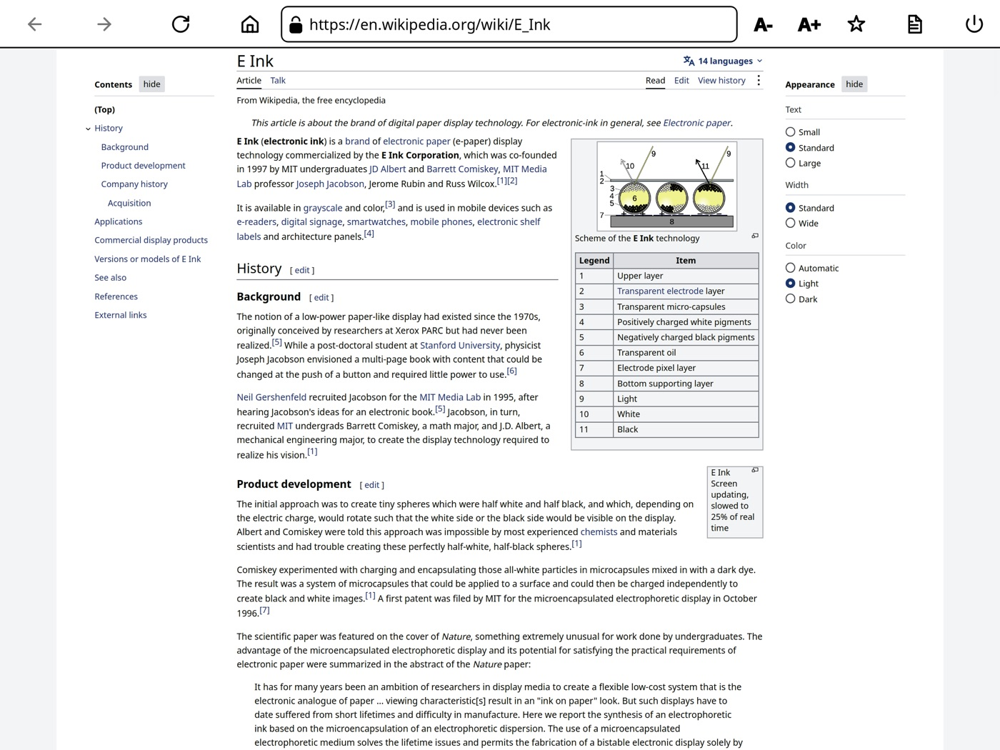
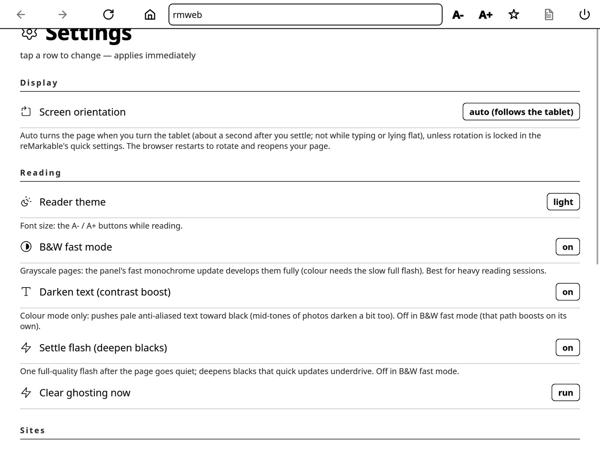

<div align="center">

# rmbrowser

**A real web browser on the reMarkable Paper Pro: in portrait or landscape, with one clean e-ink update per page.**

Wikipedia, blogs, news and arXiv straight from the tablet's own Wi-Fi. No computer, no cloud.
A fork of [rmweb](https://github.com/exp78/rmweb) with auto-rotation and a reworked e-ink refresh path.


[](LICENSE)

<a href="https://www.buymeacoffee.com/subhashjha"></a>

</div>

| Landscape | Settings |
|:---:|:---:|
|  |  |
| Wikipedia's wide layout, the tablet turned on its side | Orientation, B&W fast mode, web fonts and more |

## Install

You need a Paper Pro on **reMarkable OS 3.28 or later** with **developer mode** on. Turning
developer mode on factory-resets the tablet, so sync your notebooks first. Then, with the tablet
plugged in over USB:

```sh
git clone https://github.com/jhasubhash/rmbrowser && cd rmbrowser
ssh-copy-id root@10.11.99.1            # once: the password is under Settings → General → About
./scripts/setup-device.sh all          # browser + xovi + AppLoad + power-button toggle
```

Open **AppLoad → rmweb** on the tablet. After a reboot, triple-press the power button to bring
AppLoad back. The full walkthrough, including what to do after an OS update, is in
**[docs/paper-pro-setup.md](docs/paper-pro-setup.md)**. It's beta software that runs as root:
use it at your own risk.

## What it does

| | |
|---|---|
| 🔄 **Follows the tablet** | Turn it and the page turns with it, back on the same page at the same spot. Respects the reMarkable rotation lock; pin an orientation in Settings if you prefer. |
| 🖋️ **One update per page** | In B&W mode each page turn reaches the e-ink panel once, with a deep waveform: dark text, no flash. |
| 🧭 **Toolbar stays still** | Page turns redraw only the page; the toolbar redraws only when it changes. |
| 📖 **Made for reading** | Reader mode, bookmarks, history, in-page find, autofill and an ad and tracker blocker. |
| 📄 **PDFs to your library** | Download a PDF or EPUB (an arXiv paper, say) and it lands in the reMarkable library. |
| 🔤 **Your fonts or theirs** | Turn web fonts off for one render with the tablet's darker built-in fonts. |
| ⚡ **Builds in a minute** | `./scripts/fast-build.sh all` rebuilds the app against the release's prebuilt engine, no multi-hour WebKit compile. |

Heavy JavaScript web apps such as Gmail won't run well: the engine runs on the CPU without a
JavaScript JIT. It's a reading browser.

## Settings worth knowing

| | |
|---|---|
| **Screen orientation** | auto, portrait, landscape or landscape flipped |
| **B&W fast mode** | grayscale pages with the fastest, darkest e-ink updates; best for reading |
| **Site version** | *mobile* makes heavy news sites serve lighter pages |
| **Web fonts** | *off* for one render with built-in fonts |
| **Clear ghosting now** | one full refresh to wipe leftover images |

Open them from the start page: **Open settings**.

## Learn more

- **[Setup and recovery](docs/paper-pro-setup.md)**: install, OS updates, troubleshooting, uninstall.
- **[AGENTS.md](AGENTS.md)**: how the code is laid out, building, device testing and the e-ink gotchas.
- **[Upstream README](docs/upstream-README.md)**: rmweb's own feature list and architecture.

## Credits

The browser itself is **[rmweb](https://github.com/exp78/rmweb)** by Eugene Tarakanov (exp78)
and contributors. This fork adds landscape and auto-rotation, the single-update e-ink path, a
few fixes, and the setup and fast-build scripts. Licensed under the [MIT License](LICENSE); see
also [NOTICE](NOTICE) for the third-party components.
